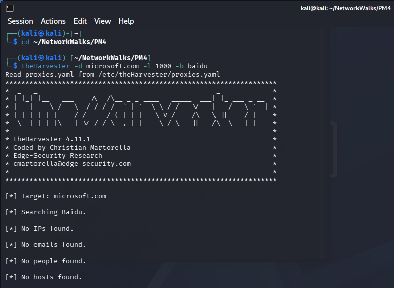
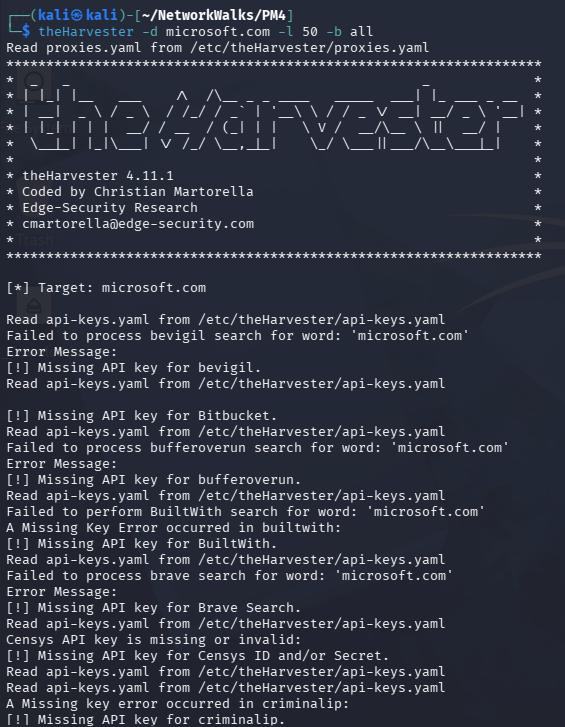
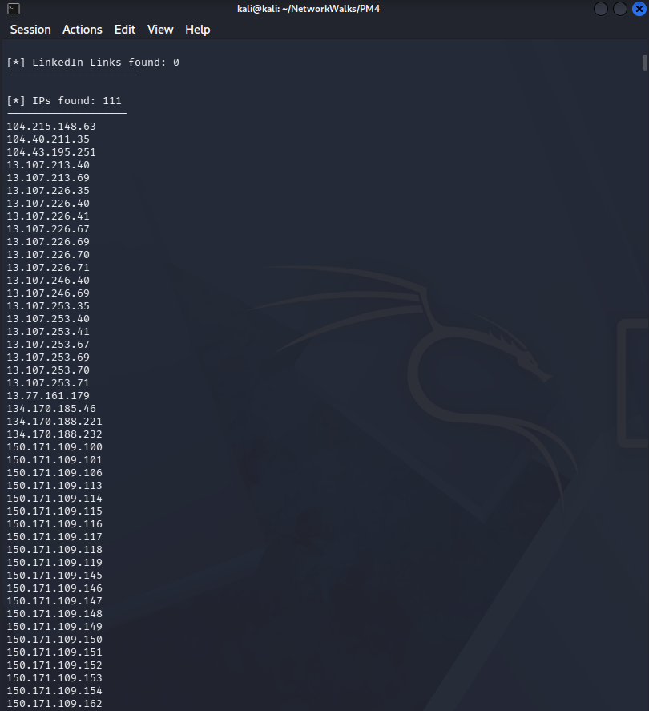
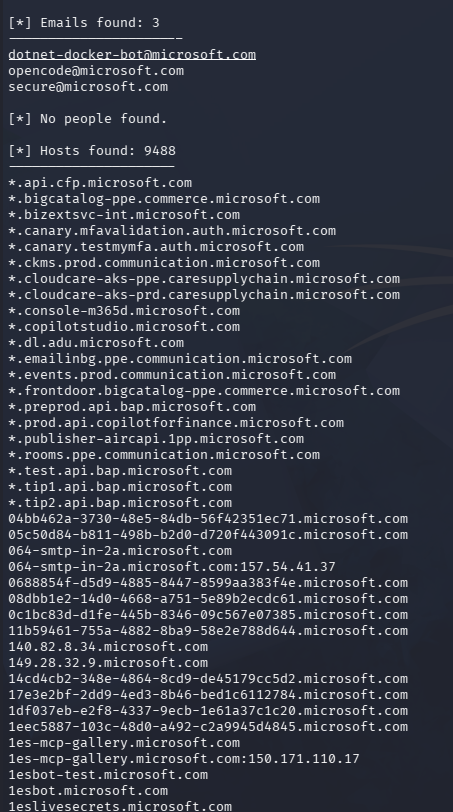
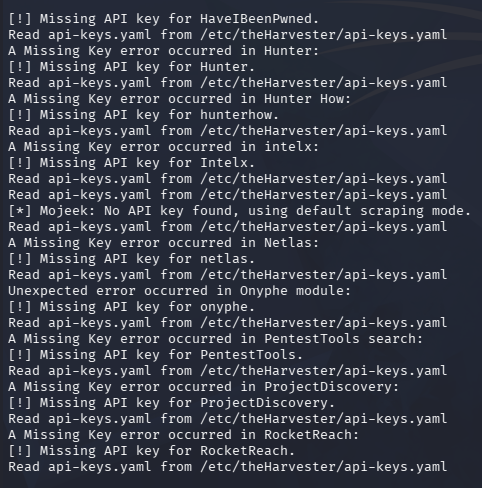

# W2-PM4: Footprinting Using theHarvester

## NetworkWalks Cybersecurity Internship – Week 2

**Intern:** Litik Aswani  
**Batch:** B084  
**Date:** 11 November 2026  
**Operating System:** Kali Linux  
**Tool:** theHarvester 4.11.1

---

## 1. Objective

The objective of this module was to perform passive reconnaissance using theHarvester and understand how publicly available information can be gathered about a target domain.

The exercise focused on identifying publicly indexed IP addresses, email addresses, and hostnames using different data sources.

## 2. Tools Used

- Kali Linux
- theHarvester 4.11.1
- Oracle VirtualBox
- Kali Linux Terminal

## 3. Target Information

**Target Domain:** `microsoft.com`

The reconnaissance was limited to gathering publicly available information. No exploitation, unauthorized access, or direct vulnerability testing was performed.

## 4. Task 1: Footprinting Using Baidu

### Command Executed

```bash
theHarvester -d microsoft.com -l 1000 -b baidu
```

### Explanation

- `-d` specifies the target domain.
- `-l 1000` specifies the result limit.
- `-b baidu` selects Baidu as the data source.

### Results

| Information | Results |
|---|---:|
| IP Addresses | 0 |
| Email Addresses | 0 |
| People | 0 |
| Hosts | 0 |

The scan completed but did not return matching information from Baidu.

### Screenshot



## 5. Task 2: Footprinting Using All Sources

### Command Executed

```bash
theHarvester -d microsoft.com -l 50 -b all
```

### Explanation

- `-d` specifies the target domain.
- `-l 50` specifies the result limit.
- `-b all` selects all supported data sources.

### Screenshot – Command Execution



### Results

| Information | Results |
|---|---:|
| IP Addresses | 111 |
| Email Addresses | 3 |
| Host Entries | 9,488 |
| People | 0 |

The scan collected publicly indexed information from multiple available sources.

The result counts were reported by theHarvester and were not independently verified.

### Screenshot – IP Addresses



### Screenshot – Emails and Hosts



## 6. API Key Limitations

During the all-sources scan, several services returned missing API key warnings.

These warnings occurred because some data sources require authentication or an API subscription.

The scan continued using other available sources.



## 7. Observations

1. Different reconnaissance sources can return different results.
2. Baidu returned no matching information during this exercise.
3. Using multiple sources provided substantially more results.
4. Some data sources require API keys.
5. Publicly indexed information can reveal details about an organization's online infrastructure.

The identified records do not necessarily represent active systems or confirmed security vulnerabilities.

## 8. Conclusion

This module provided practical experience using theHarvester for passive reconnaissance.

I learned how to execute domain-based searches, compare results from different sources, understand API limitations, and document publicly available information.

The activity demonstrated the importance of reconnaissance during the early stages of a cybersecurity assessment.

---

**Module:** W2-PM4  
**Status:** Completed  
**Internship:** NetworkWalks Cybersecurity Internship
