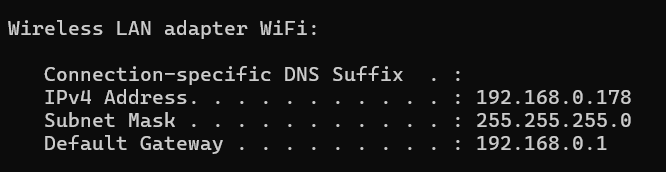
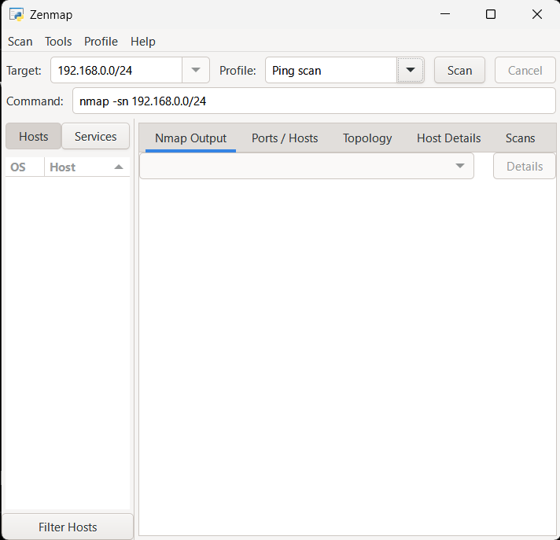
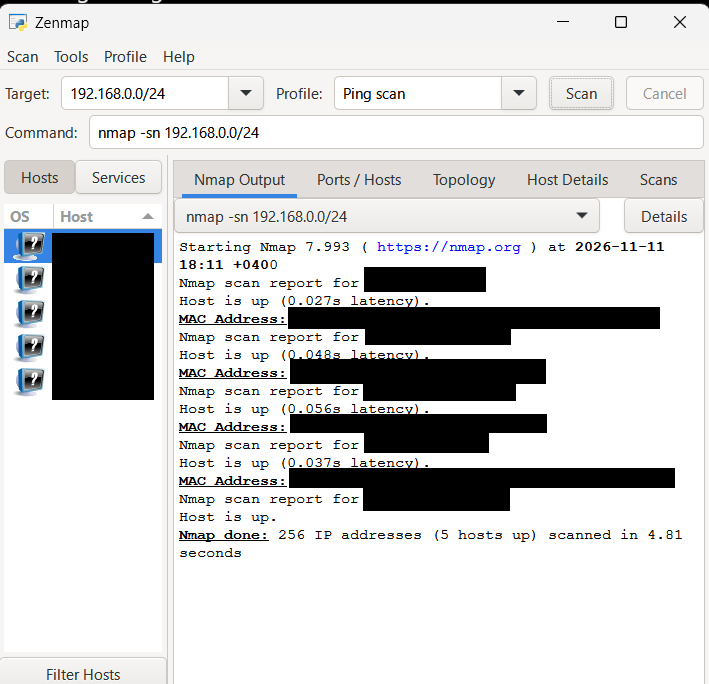
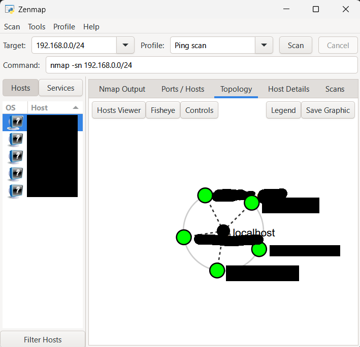

# W2-PM5: Network Scanning Using Zenmap

## NetworkWalks Cybersecurity Internship – Week 2

**Intern:** Litik Aswani  
**Batch:** B084  
**Date:** 11 November 2026  
**Operating System:** Windows 11  
**Tool:** Zenmap / Nmap 7.99.3

---

## 1. Objective

The objective of this module was to identify active devices on an authorized local network using Zenmap.

The exercise involved identifying the local network configuration, performing host discovery, and generating a network topology diagram.

## 2. Tools Used

- Windows 11
- Windows Command Prompt
- Zenmap
- Nmap 7.99.3

## 3. Identifying the Local Network

The following command was executed in Windows Command Prompt:

```cmd
ipconfig
```

The command displayed the IPv4 address, subnet mask, and default gateway.

### Network Information

| Parameter | Value |
|---|---|
| Network Range | 192.168.0.0/24 |
| Subnet Mask | 255.255.255.0 |
| Network Type | Private Local Area Network |

The scan was limited to the local network within the authorized scope.

### Screenshot – Network Configuration



## 4. Configuring Zenmap

Zenmap was configured with the following settings:

**Target:** `192.168.0.0/24`

**Profile:** Ping scan

**Command:**

```bash
nmap -sn 192.168.0.0/24
```

The `-sn` option enables host discovery without performing a port scan.

### Screenshot – Zenmap Configuration



## 5. Performing the Network Scan

After configuring the target and scan profile, the scan was executed using Zenmap.

### Scan Results

| Metric | Result |
|---|---|
| IP Addresses Scanned | 256 |
| Active Hosts Discovered | 5 |
| Scan Duration | 4.81 seconds |
| Scan Type | Ping Scan |
| Nmap Version | 7.99.3 |

The scan identified five hosts responding on the local network.

These results represent the network state observed during the scan and may change as devices connect or disconnect.

### Screenshot – Ping Scan Results



## 6. Network Topology

After the scan completed, the Topology tab in Zenmap was used to visualize the discovered network hosts.

The topology diagram displayed the discovered devices and their relationship to the scanning machine.

### Screenshot – Network Topology



### Exported Topology PDF

[View Redacted Network Topology PDF](PM5_04_Network_Topology.pdf)

The submission evidence has been redacted to protect device identifiers and private network information.

## 7. Observations

1. Zenmap provides a graphical interface for Nmap.
2. The ping scan helped identify responsive devices on the local network.
3. Five active hosts were reported during the scan.
4. Network topology visualization made the discovered devices easier to understand.
5. Host discovery does not establish whether a device contains security vulnerabilities.
6. Private network information should be protected when publishing cybersecurity reports.

## 8. Security and Privacy Considerations

The scan was limited to an owned or authorized local network.

MAC addresses and identifying network information were redacted from publicly shared screenshots and the topology PDF.

No unauthorized port scanning, exploitation, or credential attacks were performed.

## 9. Conclusion

This module provided practical experience in local network discovery using Zenmap.

I learned how to identify network settings, configure an Nmap ping scan, interpret host-discovery results, and visualize network topology.

The exercise demonstrated the importance of understanding network structure during the initial stages of a cybersecurity assessment.

---

**Module:** W2-PM5  
**Status:** Completed  
**Internship:** NetworkWalks Cybersecurity Internship
