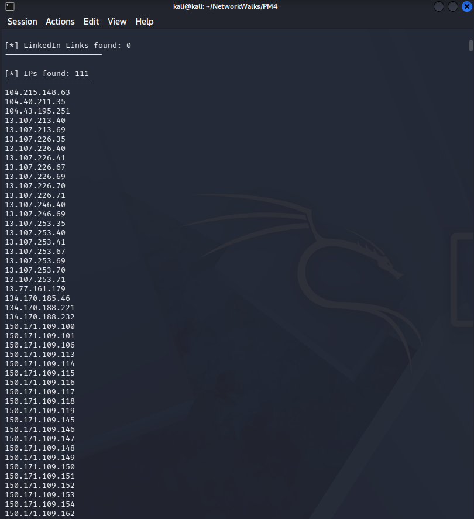
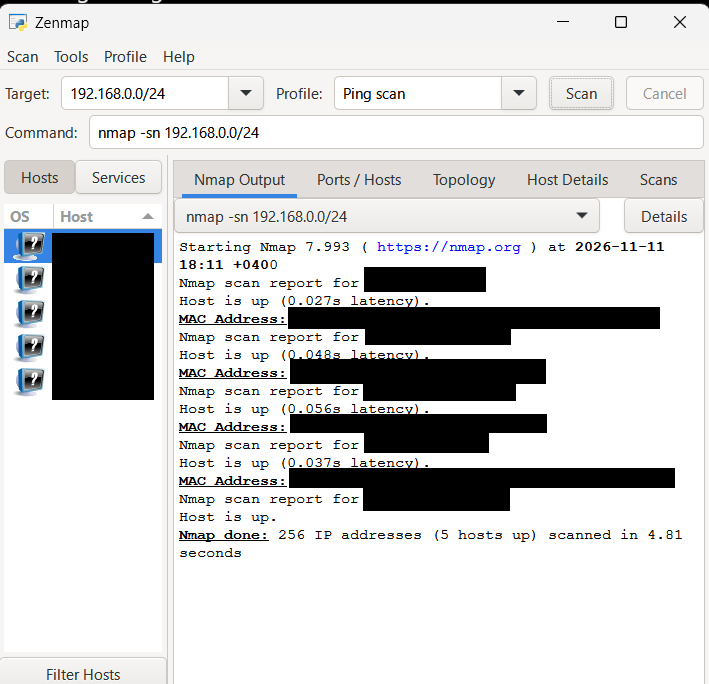

# NetworkWalks Cybersecurity Internship – Week 2

## Reconnaissance, Footprinting & Network Scanning

**Intern:** Litik Aswani  
**Batch:** B084  
**Date:** 11 November 2026  
**Organization:** NetworkWalks

---

## About This Repository

This repository documents the practical activities completed during Week 2 of my NetworkWalks Cybersecurity Internship.

The week focused on two cybersecurity assessment activities:

- **PM4:** Passive Reconnaissance and Footprinting using theHarvester
- **PM5:** Network Scanning and Host Discovery using Zenmap (Nmap)

It includes module documentation, screenshots, observations, and a complete penetration testing report.

## Completed Modules

### PM4 – Footprinting Using theHarvester

**Platform:** Kali Linux (VirtualBox)  
**Tool:** theHarvester 4.11.1  
**Target:** `microsoft.com`

Performed passive reconnaissance using Baidu and multiple supported data sources.

| Finding | Result |
|---|---:|
| Baidu results | 0 |
| IP addresses | 111 |
| Email addresses | 3 |
| Host entries | 9,488 |
| People | 0 |

**Evidence:**



[View PM4 Documentation](PM4-theHarvester/README.md)

---

### PM5 – Network Scanning Using Zenmap

**Platform:** Windows 11  
**Tool:** Zenmap / Nmap 7.99.3  
**Scan:** Ping Scan

Performed host discovery on an authorized local network and generated a topology diagram.

| Metric | Result |
|---|---:|
| IP addresses scanned | 256 |
| Active hosts | 5 |
| Scan duration | 4.81 seconds |

**Evidence:**



[View PM5 Documentation](PM5-Zenmap/README.md)

---

## Tools and Technologies

| Tool | Purpose |
|---|---|
| Kali Linux | Cybersecurity testing environment |
| Oracle VirtualBox | Virtualization |
| theHarvester | Passive reconnaissance |
| Windows Command Prompt | Network configuration |
| Zenmap | Graphical network scanning |
| Nmap | Host discovery |
| GitHub | Documentation and version control |
| Markdown | Technical reporting |

## Repository Structure

```text
.
├── README.md
├── REPORT.md
├── PM4-theHarvester/
│   ├── README.md
│   └── screenshots/
│       ├── PM4_Task1_Baidu.png
│       ├── PM4_Task2_Command.png
│       ├── PM4_Task2_API_Warnings.png
│       ├── PM4_Task2_IPs.png
│       └── PM4_Task2_Emails_and_Hosts.png
└── PM5-Zenmap/
    ├── README.md
    ├── PM5_04_Network_Topology.pdf
    └── screenshots/
        ├── PM5_01_IP_Configuration.png
        ├── PM5_02_Zenmap_Configuration.png
        ├── PM5_03_Ping_Scan_Results.png
        └── PM5_04_Network_Topology.png
```

## Final Report

The complete report covers:

1. Liability Disclaimer
2. Introduction
3. Tools Used
4. Activities Performed
5. Risk Analysis / Impact
6. Recommendations
7. Conclusion
8. Evidence Collected

**[View Complete Week 2 Penetration Testing Report](REPORT.md)**

## Key Learnings

- Performing passive reconnaissance using publicly indexed sources
- Executing theHarvester commands in Kali Linux
- Understanding reconnaissance results and API limitations
- Identifying local network configurations
- Performing host discovery using Zenmap and Nmap
- Generating and interpreting network topology diagrams
- Documenting security observations
- Protecting sensitive information in public reports

## Ethical Disclaimer

All activities were performed for educational purposes.

Reconnaissance involved publicly available information, and network scanning was limited to an owned or authorized local network.

No unauthorized access, exploitation, or credential attacks were performed.

Tool findings do not automatically indicate confirmed vulnerabilities.

---

## Acknowledgment

I would like to thank **NetworkWalks** for the opportunity to develop practical skills through cybersecurity exercises.

**Prepared by:** Litik Aswani  
**Batch:** B084  
**Week:** 2
