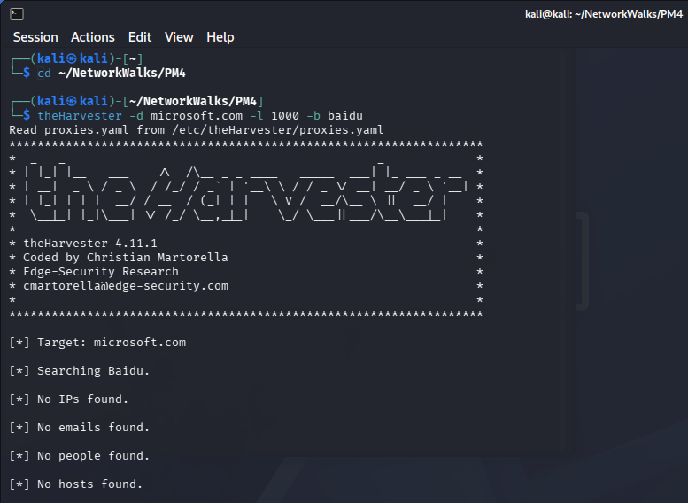
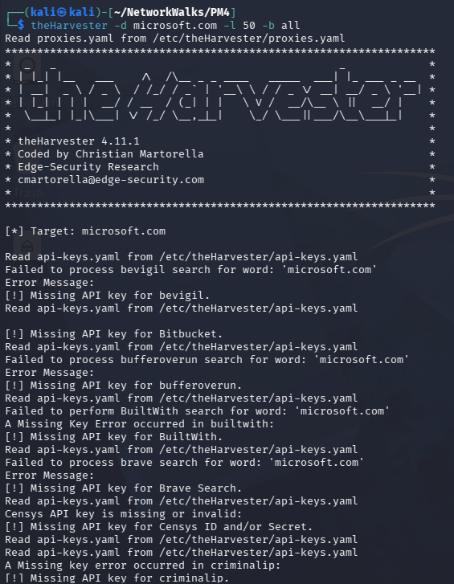
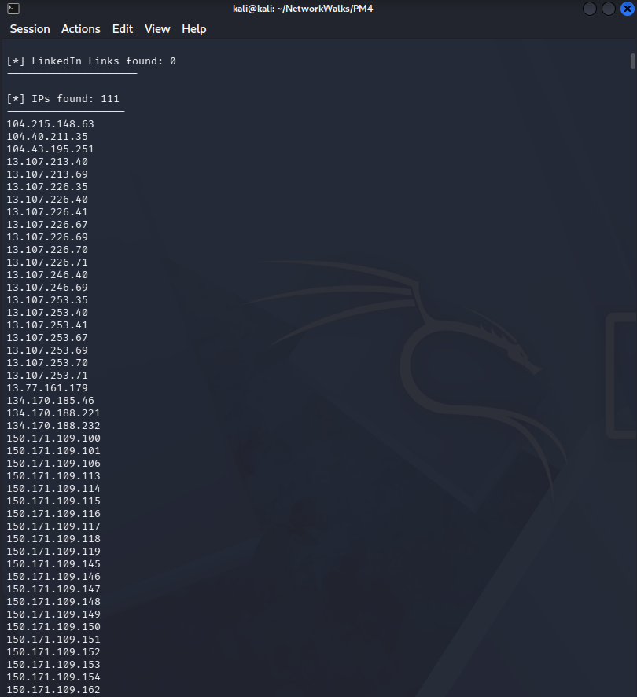
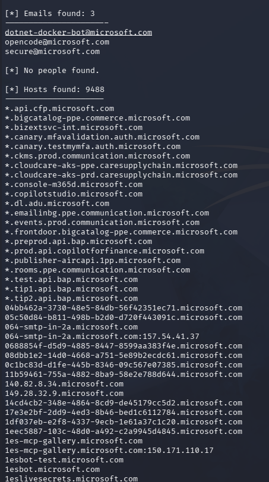
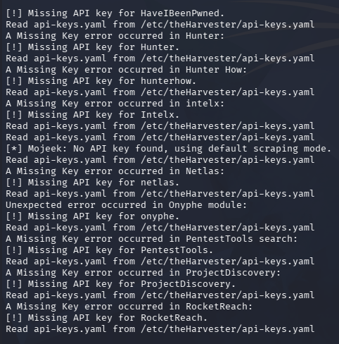
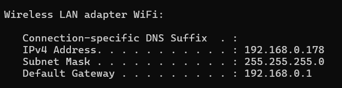
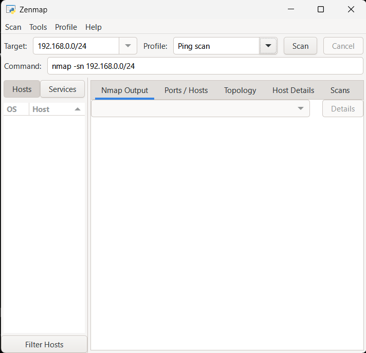
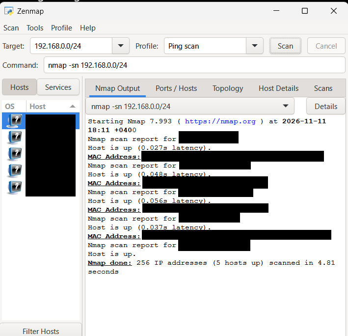
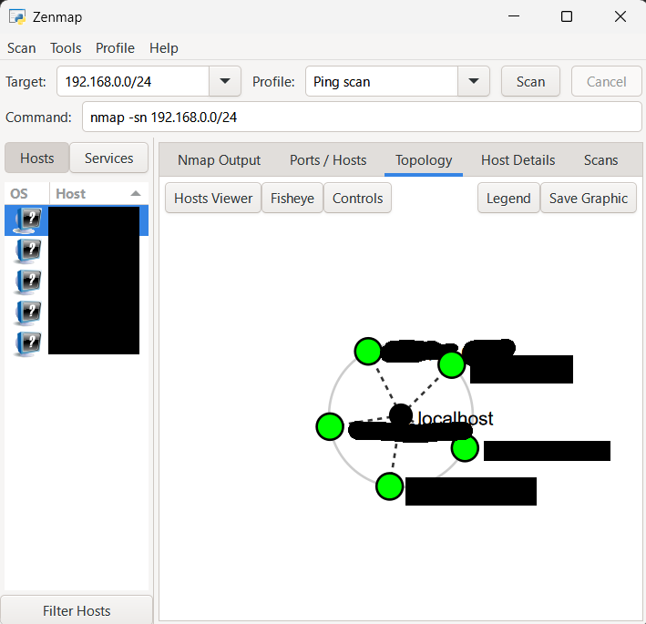

# Penetration Testing Report

## Footprinting & Network Scanning Phases

**NetworkWalks Cybersecurity Internship – Week 2**

| Field | Details |
|---|---|
| Pentester | Litik Aswani |
| Batch | B084 |
| Date | 11 November 2026 |
| Modules | W2-PM4 and W2-PM5 |
| Reconnaissance Target | microsoft.com |
| Network Target | Authorized Local Network |
| Phases | Reconnaissance, Footprinting, Network Discovery |

---

## 1. Liability Disclaimer

The activities documented in this report were performed for educational purposes as part of the NetworkWalks Cybersecurity Internship.

The footprinting exercise involved gathering publicly available information using theHarvester. The network discovery exercise involved scanning an owned or authorized local network.

No unauthorized access, exploitation, password attacks, or vulnerability exploitation was performed.

Identifying a host, domain, or IP address does not automatically indicate a security vulnerability.

## 2. Introduction

This report documents the practical cybersecurity activities completed during Week 2 of the NetworkWalks internship.

Two modules were completed:

### W2-PM4 – Footprinting with theHarvester

This module involved using Kali Linux and theHarvester to gather publicly indexed information associated with microsoft.com.

### W2-PM5 – Network Scanning with Zenmap

This module involved identifying the local network configuration, discovering active hosts, and generating a visual network topology.

The objective was to understand reconnaissance and network discovery as important early stages of cybersecurity assessment.

## 3. Tools Used

| Tool | Purpose |
|---|---|
| Kali Linux | Footprinting environment |
| theHarvester 4.11.1 | Public-source reconnaissance |
| Oracle VirtualBox | Virtualization |
| Windows Command Prompt | Identifying network configuration |
| Zenmap / Nmap 7.99.3 | Network scanning and topology visualization |

## 4. Activities Performed

### 4.1 Footprinting and Reconnaissance – W2-PM4

**Target:** `microsoft.com`

Two reconnaissance tasks were performed using theHarvester.

#### Task 1: Footprinting Using Baidu

**Command:**

```bash
theHarvester -d microsoft.com -l 1000 -b baidu
```

The command searched the target domain using Baidu as its source.

**Results:**

| Information | Count |
|---|---:|
| IP addresses | 0 |
| Email addresses | 0 |
| People | 0 |
| Hosts | 0 |

The scan completed but returned no matching information.

**Figure 1: Baidu Reconnaissance**



#### Task 2: Footprinting Using All Sources

**Command:**

```bash
theHarvester -d microsoft.com -l 50 -b all
```

This command searched the target domain across supported data sources.

**Figure 2: All-Sources Command**



**Results:**

| Information | Count |
|---|---:|
| IP addresses | 111 |
| Email addresses | 3 |
| Host entries | 9,488 |
| People | 0 |

The scan returned publicly indexed hostnames, IP addresses, and email addresses.

The findings represent theHarvester's reported results and were not independently validated.

**Figure 3: Discovered IP Addresses**



**Figure 4: Discovered Emails and Hosts**



#### API Key Limitations

Some sources generated missing API key warnings.

This limited the completeness of the results from those sources, although other available sources continued returning information.

**Figure 5: API Key Warnings**



**Detailed module documentation:**

[PM4 – theHarvester README](PM4-theHarvester/README.md)

---

### 4.2 Network Scanning – W2-PM5

Zenmap was used to perform host discovery on an authorized local network.

#### Step 1: Identifying the Network

The following command was executed in Windows Command Prompt:

```cmd
ipconfig
```

This identified the network configuration.

| Parameter | Value |
|---|---|
| Network | 192.168.0.0/24 |
| Subnet Mask | 255.255.255.0 |
| Scope | Authorized Local Network |

**Figure 6: Network Configuration**



#### Step 2: Configuring Zenmap

The following scan settings were used:

- Target: `192.168.0.0/24`
- Profile: Ping scan
- Command: `nmap -sn 192.168.0.0/24`

The `-sn` option was used for host discovery without performing a port scan.

**Figure 7: Zenmap Configuration**



#### Step 3: Performing the Ping Scan

The scan was executed against the local subnet.

**Final Results:**

| Metric | Result |
|---|---|
| IP addresses scanned | 256 |
| Active hosts | 5 |
| Scan duration | 4.81 seconds |
| Scan type | Ping scan |
| Nmap version | 7.99.3 |

The scan reported five responsive hosts.

**Figure 8: Ping Scan Results**



#### Step 4: Generating Network Topology

After the scan, the Topology tab was used to visualize discovered devices and their relationship to the scanning machine.

**Figure 9: Network Topology**



**Exported Topology:**

[View Network Topology PDF](PM5-Zenmap/PM5_04_Network_Topology.pdf)

**Detailed module documentation:**

[PM5 – Zenmap README](PM5-Zenmap/README.md)

---

## 5. Risk Analysis / Impact

The following observations were made during the two exercises.

| Finding | Potential Impact | Assessment |
|---|---|---|
| Publicly indexed hostnames | May reveal publicly discoverable infrastructure information | Informational |
| Publicly indexed email addresses | Could potentially support targeted phishing | Low |
| Discovered IP addresses | Provides information for further authorized investigation | Informational |
| Five active local hosts | Identifies responsive devices requiring verification if unexpected | Informational |
| Missing reconnaissance API keys | Limits results from some sources | Tool limitation |

These observations do not establish exploitable vulnerabilities.

No penetration attempts, credential attacks, or vulnerability exploitation were performed.

## 6. Recommendations

1. **Review publicly exposed information:** Organizations should periodically review discoverable hostnames, domains, and email addresses.

2. **Improve phishing awareness:** Personnel should receive security awareness training to recognize suspicious messages.

3. **Maintain network inventories:** Authorized network devices should be documented and reviewed regularly.

4. **Investigate unfamiliar devices:** Unexpected devices identified during network discovery should be verified by the network owner.

5. **Protect sensitive identifiers:** MAC addresses, internal network details, and infrastructure information should be protected.

6. **Document tool limitations:** Missing API keys and unavailable reconnaissance sources should be recorded.

7. **Obtain authorization:** Additional security testing should be performed only with appropriate permission.

## 7. Conclusion

During Week 2 of the NetworkWalks Cybersecurity Internship, I completed practical exercises covering footprinting, reconnaissance, and network discovery.

In the first module, I used theHarvester on Kali Linux to collect publicly available information associated with microsoft.com.

The Baidu scan returned no matching results, while the all-sources scan reported:

- 111 IP addresses
- 3 email addresses
- 9,488 host entries

In the second module, I used Windows Command Prompt and Zenmap to identify my local network and perform a ping scan.

The scan examined 256 IP addresses, reported five active hosts, and generated a network topology visualization.

These activities improved my understanding of reconnaissance techniques, network discovery, tool limitations, and technical documentation.

The exercises also reinforced the importance of responsible cybersecurity practices and working within an authorized scope.

## 8. Evidence Collected

### PM4 – theHarvester

| Figure | Evidence |
|---|---|
| 1 | Baidu reconnaissance command and output |
| 2 | All-sources reconnaissance command |
| 3 | Discovered IP addresses |
| 4 | Discovered email addresses and hosts |
| 5 | API key warnings |

[View PM4 Documentation and Evidence](PM4-theHarvester/README.md)

### PM5 – Zenmap

| Figure | Evidence |
|---|---|
| 6 | Local network configuration |
| 7 | Zenmap scan configuration |
| 8 | Ping scan results |
| 9 | Network topology |

[View PM5 Documentation and Evidence](PM5-Zenmap/README.md)

[View Exported Network Topology PDF](PM5-Zenmap/PM5_04_Network_Topology.pdf)

---

## Ethical Disclaimer

All activities documented in this report were conducted for educational purposes.

Passive reconnaissance involved publicly available information, and network scanning was limited to an owned or authorized local network.

No unauthorized exploitation or access was performed.

Sensitive identifiers should be redacted before public sharing.

---

**NetworkWalks Cybersecurity Internship**  
**Week:** 02  
**Report:** W2-PM-FINAL  
**Prepared by:** Litik Aswani  
**Batch:** B084
